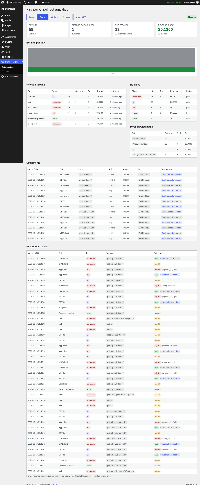

# ForgeMesh Pay-per-Crawl (WordPress plugin)

**Know who crawls your site. Charge the ones that can pay.**

Pay-per-Crawl shows you every AI crawler, SEO crawler and script that fetches your pages, verifies the real search engines by reverse DNS so SEO is untouched, and lets you answer everything else with a standard HTTP 402 price in USDC on Base, paid to your own wallet. Be clear about what pays today: x402-capable agents do; the big AI labs' crawlers (GPTBot, ClaudeBot, PerplexityBot and friends) do not yet pay anyone per page, and they simply get no content from a charging site. Until they do, this is an honest bot ledger with the price already on the door. You see who takes what, you can block or charge any of it, and when a crawler does pay, it goes straight to you. Nobody in between holds the money. Humans and verified search engines read free. Full bot analytics in wp-admin. Payments use [x402](https://x402.org).

- **Bot directory.** Every crawler the plugin knows, explained for humans: who runs it, what it does with your pages, how it is verified, its robots.txt line, and what your site currently does with it. Searchable, grouped by purpose, and it grows as new bots appear.
- **Humans see nothing different.** Browsers get the page as always.
- **Verified search engines stay free.** Googlebot, Bingbot, DuckDuckBot, Applebot are checked by reverse DNS, so SEO is untouched. A crawler that only *claims* to be Googlebot is treated as a script.
- **AI crawlers, SEO crawlers and scripts get `402 Payment Required`** with an x402 challenge (v2 header + v1 body) and an MPP challenge. An x402-capable client pays USDC on Base and retries; the page is served only after the payment settles on-chain. A crawler that cannot pay gets no content.
- **You keep 100%.** The payer's USDC goes directly to your wallet. No custody, no account, no API key.
- **Analytics.** Who is crawling (name, class, verified), how often, from how many sources, which paths, what was paid, every settlement with its transaction link. Start in *Monitor* mode to see what bots would have paid before you charge.
- **Discovery.** Serves `/.well-known/x402.json`, `/llms.txt`, `/agents.txt` and adds lines to `robots.txt`.



## Install

Download the latest `forgemesh-pay-per-crawl-<version>.zip` from [Releases](https://github.com/forgemeshlabs/forgemesh-pay-per-crawl/releases), upload it under **Plugins → Add New → Upload**, activate, then:

1. **Pay-per-Crawl → Settings**: paste your payout wallet (a `0x` address on Base), set a price (default $0.01 per page), save.
2. Watch **Pay-per-Crawl → Bot analytics** for a day in Monitor mode.
3. Switch the mode to **Charge**.

Behind Cloudflare or another proxy? Set the *Client IP header* so search-engine verification sees the real client address.

## How a payment works

This is what happens when an x402-capable client fetches a page.

1. A bot requests a page and gets `402` with the price, asset (USDC on Base) and your wallet, in the `PAYMENT-REQUIRED` header (x402 v2), the JSON body (x402 v1) and `WWW-Authenticate: Payment` (MPP).
2. The bot signs a USDC transfer authorization (EIP-3009) and retries with it in a header.
3. The plugin posts that authorization to an x402 **facilitator** (PayAI by default, no key needed; any facilitator URL can be set), which verifies it and submits it on-chain. The facilitator never holds funds.
4. The page is served only when a transaction hash comes back. The hit, payer and hash are recorded.

Without a Pro key the plugin never contacts ForgeMesh. Its only outbound requests are to the facilitator you chose, and only when a payment is presented.

## Verified

- Unit tests: `php tests/unit.php` (keccak vectors, classifier, envelopes, MPP challenge/credential, facilitator flow).
- Integration: 44 checks on WordPress 7.1 with a mock facilitator (human vs bot, 402 shapes, discovery files, v1/v2/MPP payments, replay, underpayment, admin pages).
- Real settlements on Base mainnet through PayAI, October 2026: x402 v1 ([tx](https://basescan.org/tx/0xe764d2affaca73fa225aecd383aff5969b5d9ff4e8035933b7561983f23ba7f5)) and x402 v2 ([tx](https://basescan.org/tx/0xc9755334a10b2370b2925492490fb8a3c17dbaf2f6e8661f647bb1f13cb781c2)).

## Development

```
./build.sh            # builds forgemesh-pay-per-crawl-<version>.zip
php tests/unit.php    # unit tests, no WordPress needed
```

GPLv2 or later. Made by [ForgeMesh Labs](https://forgemesh.io).
